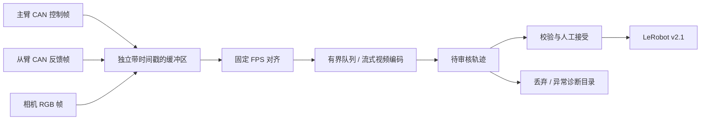

# 设计依据

## 以 EVA 与 SDK 为采集依据

EVA 当前 Piper 实机接入使用 ROS1，上游机械臂系统负责主从跟随。EVA 订阅状态和主臂命令，再记录 LeRobot。当前新实现保留这一职责分工，使用 SocketCAN 和官方 SDK parser 接入本机硬件。

| 环节 | 已核对源码 | 结论 |
| --- | --- | --- |
| Piper action 来源 | `EVA-CLIENT/configs/02_collection/dual_agilex_piper.py` | 从臂 `/puppet/joint_right` 与主臂 `/puppet/master_joint_right` 分开配置 |
| 消息订阅 | `EVA-CLIENT/src/transport/ros1.py::_init_collection_subscribers` | 状态和 action 分别订阅并保留独立队列 |
| 原始数据组织 | `EVA-CLIENT/src/transport/base.py::_collection_raw_streams` | 分别输出 `state_qpos` 与 `action_qpos` |
| 时间对齐 | `EVA-CLIENT/src/core/recorder/collection_alignment.py` | 固定 FPS；关节插值、夹爪保持、图像最近邻 |
| 保存 | `EVA-CLIENT/src/core/recorder/collection.py::_build_prepared_save_job` | 状态与 action 来自不同字段，分别写入；标准 timestamp 为帧号/FPS |
| 客户端遥操作 | `EVA-CLIENT/src/core/app/handlers/recording.py::ingest_client_teleop_action` | 记录客户端发布的目标，不用状态覆盖 action |
| 回归测试 | `EVA-CLIENT/tests/recorder/test_collection_client_pairing.py` | 明确断言客户端命令替代远端 action，不替代状态 |

EVA 的字段名可配置，默认 Piper 样例为 `observations.state.qpos` 和 `action.qpos`，不能原样交给本机 openpi 的 Piper adapter。新程序直接写该 adapter 所需的 `observation.state`、`action`、`observation.images.top_head` 和 `observation.images.hand_right`。

SDK 依据为 `/home/ubun/project/piper/openpi/piper_sdk/asserts/double_piper.MD` 和 `piper_sdk/protocol/protocol_v2/piper_protocol_v2.py`。主臂发送控制帧，从臂发送反馈帧；关节原始量为 0.001 度，夹爪原始量为微米。

新程序使用 SDK 的 `C_PiperParserV2.DecodeMessage` 解码，应用侧负责分别积累关节 1/2、3/4、5/6 和夹爪的时间序列。这样能识别仅部分关节数据停止更新的情况。使用 `can.Bus.recv` 而不调用 SDK 机械臂初始化流程，避免初始化中的发包行为。

## 时间轴与动作含义



定义 `q_follower(t)` 为从臂反馈，`u_leader(t)` 为主臂发给从臂的控制目标。新采集数据的训练含义是：

```text
observation.state[t] = q_follower(t)
action[t]            = u_leader(t)
openpi action chunk  = [u_leader(t), u_leader(t+1), ...]
joint delta[k]       = u_leader(t+k) - q_follower(t)
```

其中 `t+1` 表示下一采样步，不是一秒。夹爪默认保持绝对开度；也可在 openpi 中配置 delta。这里“主臂命令”要求确实来自驱动从臂的命令流；如果外部跟随系统又做了缩放、裁剪或滤波，应采集处理后的最终目标或明确记录变换，不能只根据话题名或 CAN 接口名猜测。

LeRobot 是存储格式，本身不规定 action 必须取主臂还是未来从臂位置。两种标签在训练中有不同语义。本实现依照 EVA 的主臂命令方案；旧采集代码不作为新实现依据，也不从旧轨迹构造或补全命令。

## 本地浏览器采集台

`web.py` 的专用后台线程拥有 `Sources`、`CaptureSession` 和 `DatasetStore`，所有改变录制状态的 HTTP 操作通过有界命令队列串行处理。浏览器只负责显示和发出操作者命令，不驱动采样；刷新、网络请求延迟和关闭页面不会打断采集时间轴。相机 JPEG 预览由独立线程缓存，视频编码仍使用已有后台写入队列。

前端复用同一个录制/审核/提交模型。已保存和待审核的视频由本机 HTTP 提供，支持 Range 请求和浏览器拖动回放。曲线读取独立的 state/action，每条最多显示 600 个采样点，原始 parquet 保留全部数据。异常、未完成或损坏轨迹可丢弃，但质量检查失败的数据不能从界面直接接受。

服务只监听回环地址，拒绝外部 Host，改变状态的请求需携带当前服务生成的令牌。所有静态资源包括 Lucide 图标均随包分发。浏览器没有使能、回零、主从切换或发送运动控制帧的接口。

openpi 对应位置：

- `src/openpi/training/config.py::LeRobotPiperDataConfig`：图像字段映射、关节 delta / 夹爪表示。
- `src/openpi/training/config.py::LeRobotPiperBookSideDataConfig`：三路图像映射。
- `src/openpi/training/data_loader.py::create_torch_dataset`：根据 FPS 与起始偏移生成动作块。
- `src/openpi/transforms.py::DeltaActions`：所有动作块元素相对当前状态做差。

## 完整性与恢复

采集中先写 `.piper/pending/<id>`。停止后关闭视频编码器，生成表格与 manifest。接受时完整解码视频、检查帧数和时间戳，然后写提交日志，移动数据文件，写入 committed 记录，再重建 LeRobot 元数据。

提交日志允许进程中断后幂等恢复；帧索引、episode 索引和 task 索引由提交阶段确定，不因丢弃轨迹产生空洞。仅支持恢复本程序创建的目录，不直接向用户的已有 LeRobot 数据集追加。

这不是数据库事务：多文件元数据更新不保证训练进程同时读取时得到一致快照，也不承诺突然断电时所有文件都已持久化到介质。训练应读取已停止采集且校验通过的数据集。进程在录制中被强制终止时，未完成的 MP4 可能无法恢复，程序不会把它当作有效样本。

## 当前边界

- 软件对齐使用主机接收时钟，硬件曝光同步和 CAN/相机延迟标定尚未实现。
- 拒绝长时间缺帧、关节流空洞和超过 10% 的相机重复源帧；短时间最近邻重复允许并记录数量。
- 保存选中帧的来源时间、关节插值两端时间与设备帧号；不保存全部高频原始 CAN 帧。
- 重置任务场景由操作者完成，采集程序不驱动机械臂回到初始姿态。
- 需要主臂/从臂外部硬件跟随已工作；软件跟随需要单独实现控制与故障处理，不应与硬件命令同时发送。
- 双臂保存格式已支持，但本机 openpi Piper 模型仍为 7 维，需扩展 adapter 后才能训练 14 维数据。


## 2026-09-16：静止采集与记录管理

主臂命令采用零阶保持，保留原消息时间，不插值未来命令；从臂关节仍线性插值并校验时间空洞。首次尚无目标时，浏览器可进入等待录制，首组目标齐全后设置有效录制起点。初始等待期间没有完整 state/action 对，不写入训练帧。同总线目标静默不能独立证明主臂是否断开，界面对此使用“目标保持”。

空格执行开始/成功保存，L 执行失败保存；失败轨迹独立放在 `.piper/failed`，区别于用户丢弃的 `.piper/rejected`。成功仍经过完整视频与表格校验。记录列表和成功/失败条数从持久化目录恢复，刷新或重启不会丢失。

删除先在同文件系统构造剩余成功轨迹的连续编号副本，重新计算索引统计、任务编号和总统计，视频用硬链接暂存；提交前写 `.piper/delete.json`，逐目录交换，重启时幂等完成交换后清理旧文件。导出用同样的子集重建方法生成标准 `success/`，失败单独打包。API 以记录版本校验选择，后台单线程串行执行，录制期间拒绝删除/导出。

2026-09-16 更新：保存与审核接口直接返回包含 `instance` / `sequence` 的提交后状态；浏览器拒绝同一实例的旧状态覆盖新状态。失败的保存也返回最新待审核状态。静态资源及 API 禁止缓存，成功/失败计数均来自持久化 catalog。

待审核不再阻止开始下一条录制。批量审核使用稳定的 recording UUID，先校验所有路径存在且无重复，再逐项执行接受/失败/丢弃；单条质量失败留下原目录并报告原因，不回滚已完成的其他条目。提交日志未完成时中止批次，后续操作沿用原有恢复流程。

指定目录导出先在目标磁盘的隐藏临时目录构建，成功后重命名发布；不覆盖已有目标，不与源数据集目录重叠。外部导出复制文件，支持不同文件系统；内部 ZIP/删除暂存沿用硬链接。失败目录改用 `episode_000000` 顺序命名，`selection.json` v2 记录原记录 ID 的映射。ZIP 不再在首个 HTTP 请求后删除，支持 Range、完整下载及重试。

真机回放实现位于 `replay.py`，独立线程和独立 SocketCAN，使用厂商消息类型与协议编码器。服务启动、轨迹预检及模拟测试不发送真实控制帧。开始要求具体轨迹版本、一次性且有时限的计划令牌及两项现场确认；与采集、修改数据、重连互斥。停止和心跳接口直接操作回放事件，不排在耗时的数据操作队列后面。发起回放的标签页每 300 ms 发心跳，其他标签页的状态轮询不续命。

回放始终验证 7 维单位契约、有限数值、CAN int32 编码范围和固定帧率时间戳。启动时先自动低速返回所选轨迹的首帧，正式播放按记录时间戳执行。实机启动监听竞争控制帧、反馈与六轴状态；运行中检查反馈新鲜度、总线错误、跟随误差、心跳与调度停顿。操作取消或运行异常后发送 0x150 快速急停，勾选夹爪回放且有新鲜反馈时发送当前位置保持；正常完成保持终点。不使能、不回零、不清除故障、不发送 MasterSlaveConfig。硬件共总线主臂须按 SDK 文档隔离，否则拒绝执行。回放结束后采集必须重连，避免将自身回放目标当作新的主臂示教动作。

真机回放默认选择 action 目标轨迹并仅执行六轴，夹爪参与为显式选项。夹爪开启后才检查其编码范围、起点与跟随误差，并发送 0x159。2026-09-17 后续按用户要求改为原值回放，移除 `SdkPositionLimits` 和单帧关节跳变拒绝；不再读取 SDK 软件位置范围，不支持自定义 `replay_gripper_max_m`。位置不做裁剪，正式轨迹也不因相邻位移较大而延长执行时间。

`encode_positions` 统一完成预检、起点接入、正常发送及夹爪停止保持的单位换算和 int32 编码范围校验。关节转为 0.001 度、夹爪转为微米，保留符号并四舍五入到协议精度；整组目标在发送第一个帧前完成校验，避免溢出回绕或部分发包。API 以 `position_policy=recorded_without_clipping` 描述此行为，界面显示“原值回放”和“无软件位置限位”。原始文件及设备固件限制不变，软件发送目标不代表设备一定执行；低速回起点、起点到位确认、故障/失联停止继续生效。

2026-09-17 后续增加自动回起点：移除起始位置必须接近首帧的启动拒绝，`RobotReplay` 在总线检查后先以当前反馈位置接管，使用 `3s^2-2s^3` 插值回到 `plan.points[0]`。返回时长为各执行轴位移除以返回速度的最大值乘 1.5，且不少于 0.5 秒，补偿三次曲线的峰值斜率。返回速度独立设置为关节 0.175 rad/s、夹爪 15 mm/s，不受播放倍率影响；未启用的夹爪不影响返回时长且不发送指令。

阶段依次为 `checking`、`moving_to_start`、`settling_start`、`playing`、`completed`。反馈连续 0.2 秒位于既有首帧容差内后才启动轨迹计时；返回插值结束后最多等待 3 秒，未到位则停止且不进入轨迹阶段。跟随误差、有限反馈、通信、故障、竞争控制、心跳和停止检查贯穿返回及回放阶段。API 的 `start_elapsed_s` / `start_duration_s` 表示返回进度，`elapsed_s` / `duration_s` 表示轨迹进度；预检返回 `start_mode=move_to_first_pose`。页面按钮改为“回起点并回放”，确认项覆盖返回路径，历史回放错误不会覆盖新一次预检结果。

2026-09-17 后续按采集原速回放：API 和网页默认倍率统一为 1.0，保留 0.5 / 0.25 倍慢放。`ReplayPlan.times = (timestamps - timestamps[0]) / speed`，删除按关节 0.35 rad/s、夹爪 30 mm/s 逐段拉伸的逻辑；启用夹爪不会改变轨迹时长。预检返回 `timing_policy=recorded_timestamps`、`trajectory_duration_s` 和 `end_hold_s=0.5`；`duration_s` 仍为二者之和，不含自动返回。SDK `asserts/double_piper.MD` 明确说明高跟随模式 `0xAD` 下速度比例无效，维持该模式，通过时间戳和实时经过时间以约 50 Hz 插值发送原始轨迹。控制目标的时间与记录一致，实际执行仍受硬件动态与故障检查影响。

2026-09-17 后续修正原速跟随检查：`TrackingGuard` 缓存成功发送的完整目标及单调时钟时间，检查时删除 150 ms 窗口外的历史，只与已经发送的目标比较。对每组完整目标计算各执行轴绝对误差除以原容差后的最大值，选择该最大值最小的一组；所有轴使用同一组目标，夹爪未参与时不影响评分。离散的发送目标不重定时，不改写文件，也不会因误差轻微超出而延迟后续发送。

匹配误差超过原容差（关节 0.25 rad、夹爪 15 mm）后启动连续超差计时，恢复到容差内立即复位，连续 200 ms 才停止；超过两倍容差立即停止。回起点和正式播放均使用此检查，首帧确认和末帧到位容差仍独立生效。循环也检查读取反馈所耗时间，读取超过 150 ms 时在发送新目标前停止。

预检声明 `tracking_policy=recent_sent_targets` 及时间窗口。运行状态包含轨迹来源、倍率、夹爪选项和 `tracking` 快照：参考目标、最后已发目标、反馈、误差、阈值、匹配目标年龄、连续超差时间、触发轴、原因、阶段与准确停止时刻。停止报错展示轴名与单位（关节 rad，夹爪 mm），异常日志记录结构化快照供停机后分析。目标年龄表示历史匹配结果，并非识别得到的硬件延迟。此策略不识别夹爪接触，夹物造成的持续位置差仍可能停止；新阈值语义是软件检查策略，尚需现场验证，不能表述为 SDK 规定或真机已通过。
